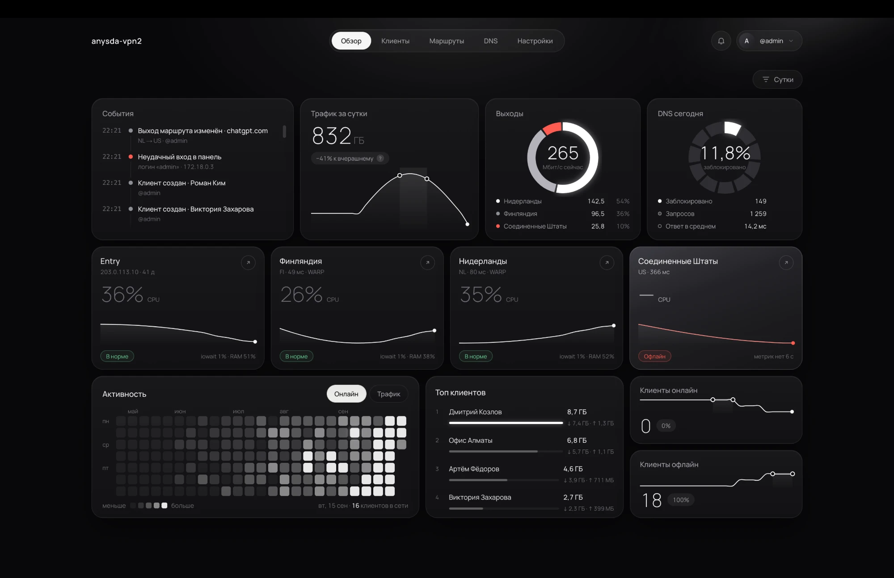
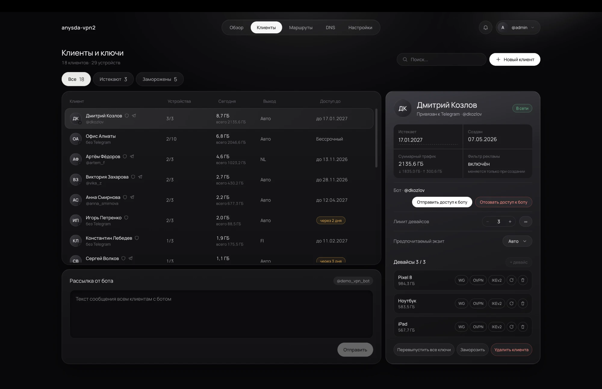

# anysda-vpn2

Самостоятельный VPN-сервис с веб-панелью: одна entry-нода в России, одна
или несколько exit-нод за рубежом, три протокола для клиентов (WireGuard,
OpenVPN, IKEv2), маршрутизация по географии, DNS с фильтрацией рекламы и
Telegram-бот. Ставится одной командой на чистые серверы.

> 🚀 **Сразу деплоить →** [Quickstart](#-quickstart--развернуть-с-нуля)



Обзор: события панели, трафик за сутки, нагрузка на экзиты, DNS с долей
блокировок. Ниже - карточки нод (CPU, iowait, RAM, статус), календарь
активности клиентов, топ клиентов по трафику и счётчики онлайн/офлайн.



Клиенты и ключи: список с трафиком за сегодня, экзитом и сроком доступа,
фильтры «истекают» и «заморожены», рассылка от бота. Справа - карточка
клиента: срок, суммарный трафик, привязка к Telegram-боту, лимит устройств,
предпочитаемый экзит. Снизу - устройства с трафиком и кнопками: WG
(`.conf`/QR), OVPN (`.ovpn`), IKEv2 (сервер, Remote ID, логин, пароль и CA
при работе без домена), перевыпуск ключей, удаление; заморозка и удаление
клиента.

## Возможности

- **Три протокола.** WireGuard, OpenVPN и IKEv2/IPsec на одной entry-ноде.
  IKEv2 работает штатными клиентами iOS, macOS, Windows и Android без
  сторонних приложений.
- **Клиенты и устройства.** Клиент - это человек, у него несколько
  устройств. У каждого устройства свои ключи WireGuard, сертификат OpenVPN
  и логин IKEv2. Лимит устройств, срок доступа, заморозка, перевыпуск
  ключей - из панели или из бота.
- **Маршрутизация по географии.** Российский трафик уходит напрямую с
  entry-ноды, зарубежный - через Hysteria2 на лучший экзит. Экзит падает -
  сторож переключает на другой за 10-14 секунд, живые соединения не
  рвутся. Подробности: [docs/routing.md](docs/routing.md),
  [docs/failover.md](docs/failover.md).
- **Аварийный режим.** Пропала entry-нода целиком - через 20 минут
  экзиты сами поднимают запасной вход на Hysteria2, бот рассылает
  клиентам аварийные конфиги, администратору - адрес и пароль аварийной
  панели. Вернулась entry - клиенты переключаются обратно, аварийный
  доступ отключается сам. Подробности:
  [docs/emergency.md](docs/emergency.md).
- **Ручные правила.** Домен, IP или подсеть на конкретный экзит,
  перетаскиванием в панели. Применяется на ходу, без перезапуска и без
  обрыва соединений.
- **Предпочитаемый экзит клиента.** Весь зарубежный трафик клиента через
  выбранную страну. Экзит пропал - трафик временно идёт через общий выбор,
  вернулся - возвращается сам.
- **YouTube без рекламы (опционально).** YouTube выводится с российского
  адреса entry-ноды, где реклама не показывается, а блокировка DPI
  обходится десинхронизацией TLS (zapret2). Видеопоток проверяется каждые
  пять минут; если обход сломался, YouTube уходит на экзиты. Подробности:
  [docs/youtube.md](docs/youtube.md).
- **Локальная сеть не ломается.** Домашние адреса (RFC1918, CGNAT,
  multicast) не уезжают в туннель: роутер, NAS, принтер и Chromecast
  остаются доступны при поднятом VPN.
- **DNS с фильтрацией.** AdGuard Home для клиентов с включённой
  фильтрацией, управление - во вкладке «DNS» панели. Подробности:
  [docs/adguard.md](docs/adguard.md).
- **Telegram-бот.** Администратор управляет клиентами и получает алерты.
  Конечный клиент по ссылке-приглашению сам скачивает конфиги, добавляет
  устройства и видит уведомления.
- **Мониторинг.** Нагрузка нод, трафик за сутки, задержка до экзитов,
  активность клиентов - в панели.
- **Резервные копии.** Один зашифрованный архив со всем нужным для
  восстановления entry-ноды, по расписанию, локально или в S3.
  Подробности: [docs/backup.md](docs/backup.md).
- **Вход в панель.** Один администратор, по желанию TOTP или SSO через
  OIDC-провайдера (проверено на Authentik): [docs/sso.md](docs/sso.md).

## Как это устроено

```
клиент WireGuard · OpenVPN · IKEv2
   │
   ▼
entry-нода (Россия)
 ├─ WireGuard / OpenVPN / strongSwan  →  sing-box (TPROXY)
 ├─ sing-box: ручные правила → YouTube → РФ напрямую → остальное на экзит
 ├─ сторож экзитов: пробы, переключение, балансировка
 ├─ zapret2: обход DPI для YouTube
 ├─ панель (Caddy, Let's Encrypt), AdGuard Home, VictoriaMetrics, бот
 │
 └─ Hysteria2 ──► exit-нода nl / fi / us / … ──► интернет
```

Exit-ноды связаны с entry-нодой туннелями Hysteria2 и служебной mgmt-сетью.
У каждого экзита два пути: прямой и через Cloudflare WARP. Полная схема
правил - [docs/routing.md](docs/routing.md).

**Стек.** Nuxt 4 (Vue 3, TypeScript) · Nuxt UI 4 · Drizzle ORM + SQLite ·
better-auth · sing-box · WireGuard · OpenVPN · strongSwan · AdGuard Home ·
VictoriaMetrics + node_exporter · Caddy · Ansible · Python
(`python-telegram-bot`).

**Структура репозитория.**

```
app/                 панель (Nuxt 4)
  shared/            данные, общие для панели, бота и деплоя
infra/
  ansible/           деплой: роль и плей на стадию, инвентарь из config.yaml
  vpn2/              пакет Python: логика на нодах и команда vpn2
  versions.yml       закреплённые версии внешних компонентов
  tools/             стенд на KVM и замер скорости
telegram/vpn2bot/    бот
deploy.sh            точка входа деплоя
setup.sh             интерактивный мастер config.yaml
config.example.yaml
docs/                инструкции и скриншоты
```

Как запускать тесты и где менять версии компонентов -
[Разработка и тесты](#разработка-и-тесты).

**Документация.**

| Файл | О чём |
|---|---|
| [docs/routing.md](docs/routing.md) | порядок правил sing-box, ручные маршруты, сплит-туннель, IPv6, почему не ходит ping, QUIC |
| [docs/failover.md](docs/failover.md) | сторож экзитов: пороги, дорожки и балансировка, выход бота, ручное выключение экзита |
| [docs/emergency.md](docs/emergency.md) | аварийный режим без entry: выбор лидера, конфиги Hysteria2, аварийная панель, возврат, порты |
| [docs/youtube.md](docs/youtube.md) | YouTube мимо экзитов: отбор трафика, стратегия десинка, A/B-проверка, видеопроба |
| [docs/backup.md](docs/backup.md) | состав архива, хранение, ротация, восстановление entry-ноды с нуля |
| [docs/creation.md](docs/creation.md) | подбор серверов до оплаты: SSH с entry, приёмка, разбор неудачи |
| [docs/recovery.md](docs/recovery.md) | замена умершего экзита, потеря entry, смена IP |
| [docs/adguard.md](docs/adguard.md) | AdGuard Home: прямой вход, учётка, лимиты |
| [docs/sso.md](docs/sso.md) | вход в панель через OIDC (Authentik) |
| [docs/speedtest.md](docs/speedtest.md) | BBR и Brutal на Hysteria2, замер скорости через туннель на стенде |

---

# 🚀 Quickstart — развернуть с нуля

Нужны: одна entry-нода в России и N exit-нод (минимум одна, лучше две-три
для отказоустойчивости). Чистая Ubuntu 24.04 или 26.04, root по
SSH-паролю. Деплой запускается с entry-ноды, она же оркестратор. Как
подобрать серверы до оплаты - [docs/creation.md](docs/creation.md).

| Нода  | Минимум                 | Рекомендуется           |
|-------|-------------------------|-------------------------|
| entry | 1 vCPU, 2 ГБ RAM, 10 ГБ | 2 vCPU, 2 ГБ RAM, 20 ГБ |
| exit  | 1 vCPU, 1 ГБ RAM, 5 ГБ  | 1 vCPU, 2 ГБ RAM, 10 ГБ |

Entry-нода упирается в процессор: один vCPU занят полностью уже на
~120 Мбит/с суммарно. Лимиты служб подбираются по памяти; на машинах
меньше 4 ГБ деплой сам включает swap-файл до 2 ГБ.

**0. Домен (необязательно).** Направьте A-запись `vpn.example.com →
<entry-ip>` заранее: DNS расходится до четырёх часов, иначе Caddy не
получит сертификат при первом запуске. Только A-запись, без AAAA.

**1. Зайти на entry-ноду.**

```bash
ssh root@<entry-ip>
```

Если до этого сделать `ssh-copy-id root@<entry-ip>`, деплой подхватит ваш
ключ и разложит его на все exit-ноды. Без этого оркестратор сгенерирует
свой.

**2. Скачать исходники.**

```bash
git clone https://github.com/anysda/vpn2
cd vpn2
```

**3. Заполнить конфиг мастером.** Ответы попадут в `config.yaml`.

```bash
./setup.sh
```

**4. Запустить деплой.**

```bash
./deploy.sh
```

Деплой сам скачивает манифест сборки ровно того commit, что лежит в
каталоге, и сверяет с ним хеши стадий и миграций, образов и загружаемых
компонентов; учётная запись GitHub не нужна. Затем ставит зависимости,
проверяет SSH ко всем нодам, поднимает mgmt-сеть и Hysteria2 на exit-нодах,
а на entry-ноде - VPN-серверы, роутер, сторож, AdGuard, мониторинг, панель
и бота. Повторный запуск безопасен: стадии идемпотентны.

Для своей работы деплой заводит на entry-ноде каталог `/opt/vpn2`:
виртуальное окружение Python с Ansible закреплённой версии и пакет `vpn2`.
Тот же пакет уезжает на exit-ноды. Ставить что-либо руками не нужно, в
системный Python ничего не попадает.

Состояние деплоя - адреса mgmt-сети экзитов, список выключенных экзитов,
манифест установленной сборки, ключи SSH нод - лежит в
`/var/lib/anysda-vpn2/state/`, а не в каталоге с исходниками. Каталог
`vpn2` можно удалить и скачать заново, установка этого не заметит.
Состояние входит в резервную копию.

Если сборка для свежего commit ещё идёт, deploy скажет об этом и ничего не
изменит: подождите 10-15 минут и запустите снова.

Если GitHub временно не отдаёт компонент (5xx, 429, обрыв), деплой повторяет
скачивание через 3, 10 и 30 с, затем берёт файл через API релизов GitHub;
хеш сверяется при любом пути. Не вышло и так - deploy назовёт компонент и
адрес: проверьте, что entry-нода видит github.com, и запустите снова.
Так же качает и `./deploy.sh --development`, хеш там закреплён в стадии.

Разовый сбой зеркала apt (5xx, 408, 429, обрыв) деплой тоже повторяет сам:
всего три попытки, через 5 и 10 с. Не помогло - строка «зеркало apt не
отдало <адрес> ...»: проверьте, что нода видит это зеркало, и запустите
снова. Ответ 404 и другие 4xx не повторяются.

**Обновление**: `git pull`, затем `./deploy.sh`.

`./deploy.sh --development` — отдельный режим разработки: разрешает
плавающие теги и локальные правки без проверки сборки.

**5. Создать первого клиента.** В панели «Новый клиент» → имя → в карточке
клиента «+ девайс» → имя. Дальше кнопки WG (`.conf` или QR), OVPN, IKEv2.

Пароль администратора, если не задан в конфиге, генерируется при первом
деплое и лежит в `/etc/anysda/admin-password.txt` на entry-ноде.

---

## Настройка

Всё задаётся в `config.yaml`, образец с комментариями -
[config.example.yaml](config.example.yaml). После правки конфига
перезапустите `./deploy.sh` целиком или нужную стадию, например
`./deploy.sh 30-frontend ru`.

### Порты и параметры клиентских VPN

```yaml
ports:
  wireguard: 51820      # UDP
  openvpn: 1194         # UDP или TCP
openvpn:
  proto: udp            # udp | tcp, с суффиксами 4/6
wireguard:
  mtu: 1420             # 1280..9000, MTU клиента и MSS сервера
  split_local: true     # обход локальных сетей клиента (WG и OpenVPN)
```

Применить: `./deploy.sh 28-wireguard ru`, `./deploy.sh 29-openvpn ru`,
`./deploy.sh 30-frontend ru`. После смены порта, протокола, MTU или обхода
локальных сетей клиентам нужно скачать конфиги заново, ключи перевыпускать
не нужно. Порт должен быть открыт во внешнем firewall хостера.

### Домен и IKEv2

Без домена панель доступна по `https://<entry-ip>/`: Caddy выпускает
сертификат Let's Encrypt на публичный IP с профилем `shortlived` (около
6 дней). Окно продления настроено на возраст сертификата 5 суток; для
домена — на оставшиеся 7 дней. ACME Renewal Information может назначить
более раннее обновление. TCP 80 должен быть доступен извне для HTTP-01,
TCP 443 — для панели; HTTP/3 выключен, UDP 443 остаётся VPN.

Если первый выпуск не завершился за минуту, deploy выводит причину и
оставляет панель по HTTP. Caddy повторяет попытки с увеличивающейся паузой.
После выпуска таймер `vpn2-tls` включает HTTPS-редирект и Secure-cookie
(однократно перезапускает панель); CSRF использует тот же режим.
Сбой обновления не отключает действующий HTTPS. Через настроенного бота
администратор получает ошибку ACME и срок сертификата, не чаще одного
уведомления за 6 часов; после восстановления — «TLS: обновлено».
При недоступном боте сообщения сохраняются до доставки (до 32 последних).
Диагностика: `journalctl -u caddy -u vpn2-tls`, `systemctl list-timers vpn2-tls`.
Без настроенного Telegram-бота доступны журнал и локальная очередь.

Укажите `panel.domain`, направьте A-запись и запустите `./deploy.sh`.
Caddy получит сертификат Let's Encrypt на домен. IKEv2 до
этого работает по IP со своим CA, после - автоматически переключается на
домен и доверие к Let's Encrypt: новым профилям CA ставить не нужно.
Профили IKEv2, выданные до подключения домена, продолжают работать:
сервер отвечает им прежним CA. Диагностика:
`journalctl -u anysda-ikev2-cert-sync -u caddy`.

### YouTube мимо экзитов

```yaml
youtube:
  route: zapret         # off | zapret | direct
  quic: block           # QUIC режется намеренно, десинк проверен на TCP
```

Проверка - только A/B, статус юнита ничего не доказывает:

```bash
ssh root@<entry> anysda-yt-check                    # 0 = обход живой
ssh root@<entry> 'journalctl -u anysda-yt-failover'  # журнал видеопробы
```

Если обход не проходит: `youtube.offload: off`, подобрать стратегию через
`/opt/zapret2/blockcheck2.sh` и записать в `youtube.strategy`, либо
`youtube.route: off`. Как это работает и что проверяет видеопроба -
[docs/youtube.md](docs/youtube.md).

### Сторож экзитов

Раз в две секунды сторож пробует каждый экзит. Три промаха подряд - экзит
считается мёртвым, новые соединения идут на другой, живые дорабатывают на
старом. Устройства разложены по 32 дорожкам, сторож держит каждую на
быстром экзите и выравнивает нагрузку. Экзит можно выключить вручную в
карточке экзита в панели. Если мертвы все каналы всех включённых экзитов
(с одним экзитом переключаться некуда), сторож перезапускает sing-box на
entry и пишет об этом в бот; настройка и выключение - ключи `failover.*`.
Пороги, балансировка, выход бота и перезапуск sing-box -
[docs/failover.md](docs/failover.md).

Стадии 20 (роутер) и 21 (сторож) обновляйте вместе:

```bash
./deploy.sh 20-ru-router ru && ./deploy.sh 21-failover-watchdog ru
```

### Отдельные стадии

```bash
./deploy.sh 30-frontend ru       # пересобрать панель
./deploy.sh 35-telegram ru       # перезапустить бота
./deploy.sh 10-foreign foreign   # все exit-ноды
./deploy.sh 19-yt-zapret ru      # обход DPI для YouTube
./deploy.sh 99-verify all        # проверка после деплоя
```

Полный список стадий и групп нод - `./deploy.sh --help`. Каждая стадия -
плей с её тегом в `infra/ansible/site.yml`, а что именно она делает на ноде,
описано в ролях `infra/ansible/roles/`. Стадия entry на экзите (и стадия
экзитов на entry) не запускается: `./deploy.sh 30-frontend se` - отказ.

### Обновление и откат панели

`git pull && ./deploy.sh` заменяет панель под защитой: новая версия
переносит базу на свою схему и должна ответить на проверку здоровья. Пока
идёт перенос, изменения из панели приостановлены, VPN продолжает работать.
Если новая панель не поднялась, деплой сам возвращает прежний образ.

Вернуть прежнюю панель вручную после удачного обновления:

```bash
./deploy.sh rollback
```

Откат меняет только образ панели. База, отзывы устройств, сроки доступа и
ключи остаются текущими, назад они не откатываются никогда. Поэтому откат
возможен, только если прежняя версия понимает нынешнюю схему базы; иначе
деплой откажет и предложит поставить совместимую сборку. Вернуть сами
данные - это `./deploy.sh restore` из резервной копии.

## Резервные копии

`./deploy.sh backup` снимает один зашифрованный архив со всем, что нужно
для восстановления entry-ноды: база панели, секреты `/etc/anysda`,
серверный ключ WireGuard, CA и PKI OpenVPN, сертификаты IKEv2, хранилище
Caddy. Архив шифруется [`age`](https://github.com/FiloSottile/age) до
записи на диск.

```bash
./deploy.sh backup                    # снять архив сейчас
./deploy.sh backup-list               # список архивов
./deploy.sh restore                   # восстановить последний (локально и в S3)
./deploy.sh restore latest --dry-run  # только показать, какой архив будет взят
./deploy.sh restore <archive> --force # перетереть непустую базу
```

По умолчанию архивы снимаются раз в сутки в 02:00 и хранятся в
`/var/backups/anysda-vpn2/` (последние 10). Для настоящего disaster
recovery архивы должны жить вне entry-ноды: S3 у другого провайдера или
синхронизация на удалённое хранилище.

**`config.yaml` - мастер-секрет.** В нём пароли всех нод, пароль панели,
токен бота, ключ оркестратора и passphrase архивов. Без passphrase архивы
нечитаемы. Храните копию вне entry-ноды, `chmod 600`, не коммитьте.

Состав архива, хранение в S3, ротация и пошаговое восстановление entry-ноды
с нуля - [docs/backup.md](docs/backup.md). Что делать, когда умер экзит
или entry, - [docs/recovery.md](docs/recovery.md).

## Telegram-бот

Опционален. Включается, если заданы `telegram.bot_token` и
`telegram.chat_id` (в `setup.sh` или в настройках панели). Админский чат -
личка с ботом или приватная группа с выключенным Group Privacy.

| Команда    | Что делает                                        |
|------------|---------------------------------------------------|
| `/clients` | список клиентов, создание, карточка с действиями  |
| `/status`  | состояние нод и задержка до экзитов               |
| `/nodes`   | список exit-нод с RTT                             |

В карточке клиента: заморозить, лимит устройств, срок, приглашение,
удалить. «Отправить приглашение» даёт ссылку `t.me/<bot>?start=…` для
пересылки клиенту: по ней бот привязывает его чат, и дальше клиент сам
скачивает конфиги, добавляет устройства и получает уведомления об
изменениях. «Отозвать доступ к боту» в панели отвязывает Telegram и
делает старую ссылку недействительной.

Бот не перевыпускает ключи, не трогает маршруты и не меняет свои
настройки - это только в панели.

## Разработка и тесты

Тесты на установку не влияют и для работы сервиса не нужны. Все команды -
из корня репозитория. Точный набор пакетов для каждого набора тестов - в
`.github/workflows/checks.yml`: CI запускает то же самое.

```bash
# пакет vpn2: разбор config.yaml, бэкап, сторож, шаги стадий
pip install ./infra/vpn2 pytest pytest-xdist
python3 -m pytest infra/vpn2/tests -n auto --dist loadgroup

# регрессии деплоя и маршрутизации
python3 infra/tests/run_parallel.py

# бот
pip install -r telegram/requirements.txt
python3 infra/tests/run_parallel.py --dir telegram/tests

# роли и плеи Ansible
pip install -c infra/ansible/constraints.txt ansible-core ansible-lint
export ANSIBLE_CONFIG=infra/ansible/ansible.cfg
export ANSIBLE_COLLECTIONS_PATH=/tmp/collections
ansible-galaxy collection install -r infra/ansible/requirements.yml \
  -p /tmp/collections
ansible-lint --profile production --offline --project-dir infra/ansible \
  infra/ansible/site.yml infra/ansible/roles

# панель: линт, типы, unit-тесты (vitest), сквозные тесты (Playwright)
cd app && pnpm install
pnpm lint && pnpm typecheck
pnpm test:unit
pnpm e2e:local
```

Сквозным тестам панели нужен Docker: `pnpm e2e:local` сам собирает образ
панели и поднимает её с подставными VPN-службами. Эталонные снимки экранов
(`app/e2e/screenshots.spec.ts`) в обычный прогон не входят и сверяются
отдельно: кнопкой запуска `shots.yml` или пушем в ветку `shots/<имя>`.

**Стенд.** Полная установка проверяется на двух виртуальных машинах под
KVM, entry и экзит, на Ubuntu 24.04 и 26.04: штатный `./deploy.sh` с
entry-ноды, затем `99-verify` с настоящим трафиком WireGuard, OpenVPN и
IKEv2, повторный деплой без изменений и восстановление из архива. В CI это
`stand.yml` на каждый пуш в `dev`. Локально, на машине с KVM:

```bash
sudo infra/tools/ci-stand.sh up
sudo infra/tools/ci-stand.sh deploy <образ панели>
sudo infra/tools/ci-stand.sh verify
sudo infra/tools/ci-stand.sh down
```

Остальные сценарии стенда перечислены в начале `infra/tools/ci-stand.sh`.

**Версии компонентов.** Версии и контрольные суммы всего, что деплой
скачивает со стороны (sing-box, AdGuard Home, Caddy, VictoriaMetrics,
zapret2, Ansible и другие), записаны в одном файле `infra/versions.yml`.
Обновить компонент - поменять строку там; при обычном `./deploy.sh`
скачанное сверяется с манифестом сборки этого commit.

## Лицензия

[MIT](LICENSE).
