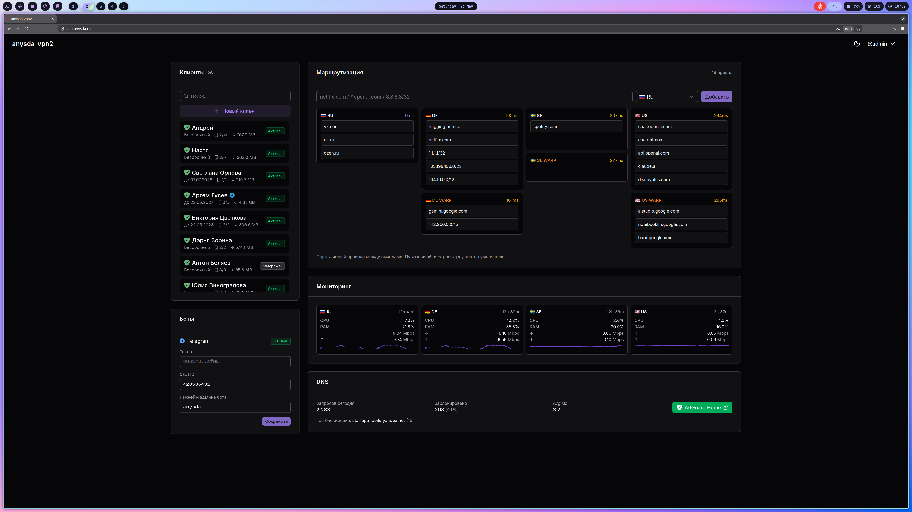
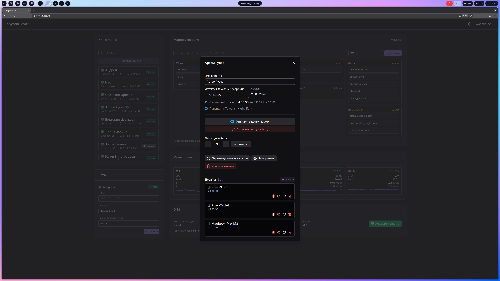

# anysda-vpn2

Веб-панель для управления многонодным VPN-стеком (WireGuard + OpenVPN +
IKEv2/IPsec) с авто-geoip-роутингом, ручными правилами (drag-and-drop),
мониторингом и Telegram-ботом для админа и для конечных клиентов.

> 🚀 **Сразу деплоить →** [Quickstart](#-quickstart--развернуть-с-нуля)



Слева — список клиентов с трафиком и статусами; центр — Маршрутизация
(drag-and-drop правил по колонкам outbound'ов RU/DE/SE/US, авто-роутинг
+ ручные правила); справа в столбце «US» — AI-сервисы, в «DE» — стриминг.
Снизу — Мониторинг нод (CPU/RAM/Mbps) и AdGuard DNS со статистикой
запросов и блокировок. Слева снизу — настройки Telegram-бота.



Карточка клиента: имя, срок, суммарный трафик, привязка к Telegram-боту,
лимит устройств, заморозка/перевыпуск/удаление. Снизу — список устройств
с per-device трафиком и кнопками: WG (`.conf`/QR), OVPN (`.ovpn`), IKEv2
(server/Remote ID/login/password и CA при работе без домена), перевыпустить ключи,
удалить устройство.

## Что внутри

- **Веб-панель (Nuxt 4):** клиенты, устройства, маршрутизация, графики,
  AdGuard, Telegram-настройки. Один admin, опционально TOTP.
- **Двухуровневая модель:** клиент (человек) → его устройства. У каждого
  устройства свои WG-ключи, OpenVPN-сертификат и IKEv2-логин/пароль.
- **Авто-роутинг (sing-box):** RU-трафик через WAN entry, заграница
  через Hysteria2 на лучший exit; быстрый failover (~5–7с).
- **Ping из VPN:** внешний IPv4 ping у WG, OpenVPN и IKEv2 сразу получает
  от entry `Destination Protocol Unreachable` (ICMP type 3/code 2).
  Это ограничение транспорта, а не признак недоступности проверяемого адреса:
  [Hysteria2](https://v2.hysteria.network/docs/developers/Protocol/#proxy-requests)
  переносит только TCP/UDP; в закреплённом
  [sing-box 1.12.25](https://github.com/SagerNet/sing-box/blob/v1.12.25/protocol/hysteria2/outbound.go#L89-L101)
  другие сети отклоняются. Отказ действует и для IP экзита, и для адресов,
  которые TCP/UDP-правила направляют напрямую. Ответы удалённых адресов не
  имитируются, ICMP не уходит с IP entry в обход выбранного экзита.
  Ping собственных адресов entry остаётся локальным; успешный ответ
  проверяет только туннель до entry. ICMP-ошибки и PMTU этим правилом не
  блокируются, маршрутизация TCP/UDP прежняя. Для проверки внешнего пути
  используйте HTTP(S), например `curl -4 https://api.ipify.org`.
  Правило видно в `iptables -S FORWARD` по комментарию
  `vpn2: Hysteria2 has no ICMP`. Граница: только IPv4 echo-request,
  пришедший в VPN; исключённые split-tunnel адреса идут обычным путём клиента.
  Настоящий ping через выбранный экзит потребует отдельного IP-туннеля
  entry–exit и согласования его маршрутов с sing-box.
- **YouTube мимо экзитов (опционально):** выходит с РФ-адреса entry —
  YouTube не крутит рекламу на российских IP, — а DPI обходится десинком
  TLS (nfqws2/zapret2), отбор трафика по SO_MARK от sing-box.
- **Ручные правила:** домен/IP → конкретный outbound, drag-and-drop в
  UI; sing-box подхватывает без рестарта клиентов.
- **Сплит-туннель по локалкам (по умолчанию вкл.):** RFC1918, CGNAT
  (`100.64/10`) и multicast не уезжают в VPN — роутер, NAS, принтер,
  Chromecast и docker-сети остаются доступны при поднятом туннеле.
  В WG это дополнение `0.0.0.0/0` в `AllowedIPs` (с дыркой под endpoint,
  иначе wg-quick ловит петлю), в OpenVPN — `route … net_gateway`.
  Выключается `WG_SPLIT_LOCAL=false`, см. `server/utils/allowed-ips.ts`.
- **ULA fast-fail для IPv6 (WireGuard):** `AllowedIPs` пропускает клиента
  в `2000::/3` (реальный интернет, чтобы v6 не утёк мимо VPN к оператору),
  но v6-адреса на туннельных интерфейсах нет, поэтому раньше пакет уходил
  в туннель и там молча пропадал (клиент ждёт таймаут, у Telegram на
  IPv6-only сотовых сетях так падало каждое третье соединение). Теперь у
  клиента и у хаба есть парный ULA-адрес `fd66:66::N/64` (N тот же, что в
  `10.66.66.N`), а хаб отвечает на любой v6 с `wg0` мгновенным ICMPv6
  `destination unreachable`: приложение получает отказ за один RTT и тут
  же берёт v4. **Старым клиентам нужно перекачать `.conf`/QR**, новый
  ULA-адрес прописывается только в свежем конфиге.
- **AdGuard Home:** DNS + блок-лист для VPN-клиентов с включённой
  фильтрацией. В панели `/adguard/` вход автоматический. Для прямого входа
  (через SSH-туннель к локальному порту AdGuard) логин — `admin.user`,
  пароль — содержимое `/etc/anysda/adguard-password.txt` на entry, доступное
  только root. Если установочный пароль панели длиннее 72 байт UTF-8,
  AdGuard получает 64-символьный SHA-256 от `vpn2-adguard-v1`, нулевого байта
  и полного пароля; короткие пароли остаются прежними. Пароль панели не
  обрезается. Деплой и restore заново согласуют эту учётку с прокси панели;
  изменение пароля в профиле панели не меняет установочную учётку AdGuard.
- **Telegram-бот:** админ управляет клиентами командами `/clients`,
  получает алерты; конечные клиенты сами получают конфиги, добавляют
  устройства и видят уведомления об изменениях.
- **Мониторинг:** карточки нод (CPU/RAM/RX/TX), RTT по выходам, графики;
  `node_exporter` → VictoriaMetrics + clash-api sing-box.
- **Деплой одной командой:** `./setup.sh` → `./deploy.sh`. 13 стадий,
  идемпотентно, без ручных шагов на нодах.

## Стек

Nuxt 4 (Vue 3, TS strict) · Nuxt UI 4 (Tailwind v4) · Nitro · Drizzle
ORM + libSQL (SQLite) · better-auth (сессии, TOTP, OIDC; пароли Argon2id) ·
sing-box (Hysteria2) · WireGuard (kernel) +
OpenVPN + strongSwan (IKEv2/IPsec, EAP-MSCHAPv2) · AdGuard Home ·
VictoriaMetrics + node_exporter · Caddy
(reverse-proxy + Let's Encrypt) · Python (`python-telegram-bot`) для
бота. Образы — `node:24-slim` (панель), `python:3.13-slim` (бот).

## Архитектура

```
WireGuard client  ·  OpenVPN client  ·  IKEv2 client (iOS/macOS/Win/Android)
   │ wg0 udp/51820        tun0 udp/1194    udp/500 IKE + udp/4500 ESP/NAT-T
   ▼
[entry-нода]
 ├─ WireGuard (wg0) + OpenVPN (tun0) + strongSwan (xfrm0)
 │   iptables PREROUTING -i wg0/tun0/xfrm0 → TPROXY → sing-box :7898
 ├─ sing-box роутер
 │   ручные правила → /etc/anysda/manual-routes.json
 │   YouTube → youtube-ru (WAN entry, РФ-IP) + метка → nfqws2-десинк
 │   geoip:ru / .ru/.рф → direct-ru (WAN entry)
 │   клиентский VPN-IP → lane-00..31 (дорожки; экзит каждой выбирает watchdog,
 │                       BALANCE=on — активные устройства по быстрым экзитам)
 │   остальное → foreign-best (hy2-* exit'ы; выбирает failover-watchdog)
 ├─ nfqws2 (zapret2) — обход DPI для YouTube, только помеченный трафик
 ├─ anysda-vpn2 panel  (Caddy → :51821)
 ├─ AdGuard Home (интерфейс — в панели по /adguard/)
 ├─ VictoriaMetrics (scraping mgmt-mesh 10.99.0.0/24)
 └─ Telegram-бот (контейнер) — егрессит в Telegram через exit
       hy2-{tag}-direct → exit-нода → internet
```

## Структура

```
vpn2/
├── app/                      # Nuxt 4 панель
├── infra/                    # bash + python оркестратор деплоя
│   ├── deploy.sh             # главный pipeline
│   ├── lib/                  # config2env, gen-router-config, failover-watchdog, ssh
│   ├── configs/              # шаблоны конфигов (envsubst)
│   ├── tools/                # speedtest.py — замер скорости через туннель на стенде
│   └── scripts/              # стадии 00 / 05 / 10 / 19 / 20 / 21 / 22 / 25 / 28 / 29 / 30 / 35 / 99
├── telegram/                 # Python бот (опциональный)
├── deploy.sh                 # entry-point, делегирует infra/deploy.sh
├── setup.sh                  # интерактивный мастер config.yaml
└── config.example.yaml       # шаблон конфигурации
```

---

# 🚀 Quickstart — развернуть с нуля

Нужны: 1 entry-нода в России (2 ГБ RAM, 20 ГБ диск) и
N exit-нод (минимум 1, рекомендую 2–3 для failover; 1 ГБ RAM, 5 ГБ
диск). Все — чистая установка, root по SSH-паролю.
Поддерживаются Ubuntu 24.04 и Ubuntu 26.04.
Разворачивается с entry-ноды — она же оркестратор.

### 0. (если нужен HTTPS-домен) — A-запись за 4 часа до деплоя

`vpn.example.com → <entry-ip>`. DNS прогревается до 4 часов; ставь
заранее, иначе Caddy не получит сертификат при первом запуске.

### 1. Подключиться к entry-ноде

```bash
ssh root@<entry-ip>
```

> *(Опционально, до подключения)* `ssh-copy-id root@<entry-ip>` — кладёт
> твой публичный ключ на entry. Деплой подхватит его и при бутстрапе
> раскатает на все exit-ноды — после этого по всему стенду ходишь по
> ключу. Без этого шага деплой тоже работает: оркестратор сам сгенерит
> ключ на entry и распространит уже свой.

### 2. Склонировать репозиторий 

```bash
git clone https://github.com/anysda/vpn2 /opt/anysda-vpn2
cd /opt/anysda-vpn2
```

### 3. Заполнить конфиг мастером

```bash
./setup.sh
```

Записывает ответы в `config.yaml`

### 4. Запустить деплой

```bash
./deploy.sh
```

Сам поставит локальные зависимости, проверит SSH ко всем нодам,
развернёт mgmt-mesh, поднимет Hysteria2 на exit'ах, WG + OVPN +
sing-box-роутер + failover-watchdog + AdGuard + VictoriaMetrics +
панель + бота на entry. Идемпотентно — можно перезапускать.

### 5. Создать первого клиента

В панели: «➕ Новый клиент» → имя → «Создать» → откроется карточка
клиента → «➕ Добавить устройство» → имя → «Создать». Дальше — кнопки
«Скачать WG / .conf / QR» или «Скачать OVPN».

---

## Перезапуск отдельных стадий

### Порты и параметры клиентских VPN

Настройки задаются в `config.yaml`; `./deploy.sh` при каждом запуске заново
генерирует `infra/envs/*.env`. Передача `WG_LISTEN_PORT=… ./deploy.sh …`
не задаёт порт удалённой стадии. Например:

```yaml
ports:
  wireguard: 51830
  openvpn: 1194
openvpn:
  proto: tcp
wireguard:
  mtu: 1420
  split_local: true
```

Порты — целые числа 1–65535. `openvpn.proto` принимает `udp`, `udp4`, `udp6`,
`tcp`, `tcp4`, `tcp6` и синонимы `tcp-server`, `tcp4-server`, `tcp6-server`.
IPv6-варианты требуют доступного IPv6 на сервере и у клиента.
`wireguard.mtu` (1280–9000) задаёт MTU клиентского WG-конфига и серверный MSS;
подбирайте его под MTU пути. `wireguard.split_local: false` направляет локальные
сети клиента в VPN **для WG и OpenVPN**, отключая их обход.
Без этих ключей сохраняются прежние умолчания: WG UDP/51820, OpenVPN UDP/1194,
MTU 1420, обход локальных сетей включён. Ошибки значений останавливают
генерацию до записи env.

```bash
./deploy.sh 28-wireguard ru
./deploy.sh 29-openvpn ru
./deploy.sh 30-frontend ru
```

Первые две стадии применяют параметры серверов и правила firewall, третья
обновляет параметры выдачи клиентских конфигов в панели. После смены порта,
протокола, MTU или обхода локальных сетей скачайте конфиги клиентов заново;
перевыпуск ключей не нужен. Номер порта должен быть свободен и разрешён
во внешнем firewall хостера.

### Добавление домена и IKEv2

Укажите `panel.domain` в `config.yaml`, направьте A-запись на entry и
запустите `./deploy.sh` один раз. Caddy получает сертификат Let's Encrypt;
IKEv2 до этого работает с IP и своим CA, затем автоматически переключается
на домен. Наблюдение за сертификатом и страховочная проверка каждые 30 с
работают и после завершения деплоя, включая продление сертификата.
Срок выдачи зависит от DNS, доступности портов 80/443 и ACME; сводка деплоя
показывает фактический режим и сообщает, если сертификат ещё ожидается.
Диагностика на entry: `journalctl -u anysda-ikev2-cert-sync -u caddy`.

**IKEv2-профили, выданные до подключения домена, нужно скачать заново.**
После перехода получите актуальные настройки в карточке устройства или
через Telegram: сервер и Remote ID / Server identity становятся доменом,
вместо прежнего anysda CA используется системное доверие к Let's Encrypt.
Логин и пароль сохраняются; кнопка перевыпуска ключей не нужна.
Панель выдаёт поля для ручной настройки, `.mobileconfig` и `.sswan` не создаёт.
Два серверных сертификата не гарантируют совместимость: Android strongSwan
без явного Server identity не передаёт ожидаемую идентичность в IDr.
Уже открытая карточка не обновляется автоматически — откройте её заново.

AdGuard доступен по адресу панели с путём `/adguard/`; прямой порт `:3001`
закрыт. Например: `https://vpn.example.com/adguard/`.

### Запуск стадии вручную

С entry-ноды:

```bash
./deploy.sh 30-frontend ru       # пересобрать панель
./deploy.sh 35-telegram ru       # перезапустить бота
./deploy.sh 10-foreign foreign   # все exit-ноды
./deploy.sh 19-yt-zapret ru      # пересобрать/перенастроить обход DPI YouTube
./deploy.sh 99-verify all        # smoke-тест
./deploy.sh 20-ru-router ru && ./deploy.sh 21-failover-watchdog ru   # маршрутизация и вотчдог
```

Стадии 20 и 21 обновляйте вместе. Группы `tg-best` и `pin-*` создаёт стадия 20,
а ведёт их вотчдог из стадии 21: новый конфиг со старым вотчдогом оставит бота
на первом попавшемся выходе, а ручные маршруты без запасного; новый вотчдог со
старым конфигом не найдёт, чем управлять.

## Замер скорости через туннель

Hysteria2 между хабом и экзитами по умолчанию использует BBR. Для сравнения
с Brutal можно задать у нужного элемента `exits` в `config.yaml` обе скорости:
`hy2_up_mbps: 200` (экзит → хаб) и `hy2_down_mbps: 100` (хаб → экзит).
Это пример: подставляйте измеренную ёмкость своего пути в целых Мбит/с.
Применить: `./deploy.sh 10-foreign <тег>`, затем `./deploy.sh 20-ru-router ru`.
Для возврата на BBR удалите оба поля и повторите эти стадии. Настройка
затрагивает direct и WARP выбранного экзита; служебный hy2-mgmt остаётся на BBR.
Brutal пока требует A/B-проверки на своём пути: критерий — прирост от 20%
при потерях 1%/3% без ухудшения задержки под нагрузкой. Скорости задаются
на соединение, это не общий ограничитель канала экзита.

`infra/tools/speedtest.py` снимает на стенде одну таблицу: iperf3 TCP (1 и 8
потоков в обе стороны) и UDP через туннель клиент → entry → экзит → сервер,
TTFB HTTPS к зарубежным и российским сайтам, пачку DNS-запросов к AdGuard и
приросты счётчиков узлов (`UdpRcvbufErrors`, ретрансмиты, `tc -s qdisc`, ЦПУ).
Прогоняет все экзиты из `config.yaml` хаба, переключая клиентам
`preferredExit` через панель. Нагрузочный замер — только на стенде, не на проде.

Что нужно заранее:
- ssh по ключу (через ssh-agent) на entry и в каждую машину-клиент; на экзиты
  скрипт ходит через entry;
- машина за экзитом с `iperf3 -s` на портах 5201, 5202, … (по порту на клиента);
- клиенты — по машине на протокол (WireGuard, OpenVPN, IKEv2) с поднятым
  туннелем и DNS туннеля; у каждого свой клиент в панели; на них стоят
  `iperf3`, `curl`, `ping`, `python3`.

```bash
infra/tools/speedtest.py --hub root@<entry> --iperf <iperf-сервер> \
  --client wg=root@<клиент-wg>/<имя-в-панели> \
  --client ovpn=root@<клиент-ovpn>/<имя-в-панели> \
  --client ikev2=root@<клиент-ikev2>/<имя-в-панели> \
  --out before.json > before.md
# после правки — тот же запуск с --out after.json, затем:
infra/tools/speedtest.py --compare before.json after.json
```

Путь до iperf-сервера проседает на минуты целиком, поэтому прогон идёт
кругами (`--repeat`, по умолчанию 5): каждый круг проходит все экзиты и всех
клиентов, в таблицу идёт медиана по кругам. Полный прогон трёх клиентов по трём
экзитам идёт около 45 минут.

---

## YouTube — почему он идёт мимо экзитов

Включается секцией `youtube:` в `config.yaml` (`route: zapret`), по умолчанию
выключено.

**Смысл.** YouTube не крутит рекламу на российских IP. Через зарубежный экзит
сайт видит иностранный адрес — и реклама включается. То есть VPN «чинит»
доступ и ломает ровно то, ради чего его ставили семье. Поэтому YouTube
выводится **прямо с entry-ноды** (московский адрес), а блокировка DPI
обходится **десинком TLS**, а не туннелем. Побочный плюс: самый тяжёлый
трафик перестаёт есть канал экзита.

**Как отбирается трафик.** sing-box (стадия 20) отправляет YouTube в отдельный
outbound `youtube-ru` с `routing_mark`. Ядро ставит метку на сокет, а
nft-цепочки стадии 19 забирают в `nfqueue` **ровно помеченный** TCP/443 —
ничего больше с ноды в очередь не попадает. Списки IP/CIDR вести не нужно:
что считать YouTube, решает роутер по домену (`geosite:youtube` + суффиксы,
включая `googlevideo.com` — это само видео).

**Порядок правил критичен.** YouTube-правила стоят выше `geoip: ru`. GGC-хосты
(`rrN---sn-*.googlevideo.com`) физически стоят у российских провайдеров, и
geoip увёл бы их в `direct-ru` — тот же выход, но **без метки**, то есть без
десинка. Симптом: «морда открывается, видео виснет».

**Стратегия десинка** (`youtube.strategy`, по умолчанию
`wssize:wsize=1:scale=1` + `multisplit:pos=10,midsld:seqovl=1`). DPI режет не
только ClientHello, но и ответ сервера у части узлов `googlevideo.com`:
морда открывается, часть видео висит. ServerHello проходит, только если окно
клиента на рукопожатии не больше 2 байт (`wsize=1`, `scale=1`); `scale=6` даёт
64 байта и уже не помогает. Подменённый в SYN масштаб действует на всё
соединение, а ядро пишет окно под свой (обычно 9), поэтому стадия 19 ставит в
nft поправку окна: `tcp window << (масштаб ядра − scale)`. Сдвиг считается из
`scale` текущей стратегии и замера ядра; без `wssize` поправки нет. Без неё
видео идёт на единицах КБ/с. Потолок скорости одного соединения при `scale=1`
— 128 КБ за RTT (замер на проде: 1.6-2.8 МБ/с, видео хватает).

**QUIC режется намеренно** (`quic: block`): десинк проверен на TCP-TLS, а на
UDP/443 плеер висит до таймаута. Блок заставляет откатиться на TCP сразу.

**Проверка — только A/B.** Статус юнита ничего не доказывает: nfqws2
поднимается и с нерабочей стратегией. На entry лежит `anysda-yt-check`: он
дёргает один и тот же хост из-под диаг-юзера (его трафик nft метит той же
меткой — это ровно клиентский путь) и из-под root (чистый путь провайдера).

```bash
ssh root@<entry> anysda-yt-check          # 0 = обход живой
ssh root@<entry> 'nft list table inet ytzapret'      # счётчики очереди
ssh root@<entry> 'journalctl -u anysda-yt-nfqws -n 30'
```

Стадия 19 выполняет A/B-проверку и при её неуспехе печатает предупреждение;
установка продолжается. Итоговый `99-verify` отдельно показывает отказ (✗)
или отсутствие измерения (?), а ошибки самой установки останавливают стадию.

**Автопереключение измеряет видеопоток.** Раз в пять минут после завершения
предыдущего запуска `anysda-yt-failover` проверяет очередь и A/B-путь, затем
получает через yt-dlp HTTPS-видео клиента `web_embedded` и скачивает первые
4 МиБ Googlevideo под тем же диагностическим пользователем. Клиент выбран
явно: автоматический выбор yt-dlp может вернуть VISIONOS URL без PO-токена,
на который CDN отвечает 403. `web_embedded` позволяет измерять обычный поток
без cookies, входа и сервиса генерации токенов. Это проверка TCP с entry через
zapret, а не скорости VPN или QUIC.

Успех — HTTP 206, тип `video/*`, все 4 МиБ и не менее 250000 байт/с
(2 Мбит/с). Три измеренных провала подряд переводят `youtube-auto` на
`foreign-best`, три успеха возвращают `youtube-ru`. Остановленный zapret,
сетевой таймаут или медленное видео дают `bad`; `--status` и `99-verify`
показывают ✗ при последней неудачной пробе, даже после перехода на VPN.
Запасной выход этим измерением не проверяется.

Граница способа: тестовый ролик должен быть длинным, общедоступным и разрешать
встраивание (`YT_PROBE_VIDEO` в окружении службы позволяет заменить его).
Если YouTube изменит требования клиента, запретит встраивание, потребует вход
или вернёт 403/429, проба пишет **«не измерено»**, сохраняет счётчики и текущий
маршрут. В журнале остаются причина, выбранный клиент, а при ответе CDN —
HTTP-код, байты, скорость и имя CDN; подписанный URL не печатается.
`99-verify` показывает **? yt-failover**, а не ✓; алерт боту отправляется при
входе в это состояние и при возобновлении измерений, если бот настроен.
Проверка одной страницы YouTube не заменяет видеопробу. Нужно проверить
ролик, yt-dlp и требования клиента, повторить `systemctl start
anysda-yt-failover.service` и посмотреть `journalctl -u anysda-yt-failover`.
Замер старше 600 секунд также считается непроверенным.

**Если A/B не проходит:**

1. `youtube.offload: off` — TSO/GSO на WAN может склеить ClientHello в
   super-пакет, и резать будет нечего;
2. подобрать стратегию: `/opt/zapret2/blockcheck2.sh` на entry, результат — в
   `youtube.strategy`;
3. `youtube.route: off` — откат к прежнему поведению (YouTube через экзиты,
   с рекламой, но работает).

Дома этот же приём применён на отдельном боксе (CT302 за VyOS); там отбор идёт
списками сетей, и они протухают молча. Здесь этой проблемы нет by design.

---

## Failover-вотчдог экзитов

**`interrupt_exist_connections: false`** на всех трёх группах sing-box
(`direct-best`, `warp-best`, `foreign-best`). Переключение на новый экзит
берёт только НОВЫЕ соединения; живые (в т.ч. идущая загрузка) дорабатывают на
старом. Раньше каждое переключение рвало всё сразу - при 63 переключениях за
7 дней это било по всем клиентам, а не только по тем, чей экзит правда умер.

**Пороги вотчдога** (`infra/scripts/21-failover-watchdog.sh`):
`PROBE_TIMEOUT_MS=3000`, `DEAD_AFTER=3` - отсекают короткие всплески (2
промаха по 1500 мс с возвратом через 2 минуты). Цена - настоящий простой
экзита клиент видит 10-14 с: до 2 с ожидания тика (`INTERVAL=2`), первый
промах по таймауту 3 с, ещё две до-проверки по 0,4 + 3 с, и лишь потом
переключение; дальше клиенту нужно открыть новое соединение.

Возврата на «первый» экзит нет: после восстановления старый экзит снова
выбирается, только если он быстрее текущего больше чем на `TOLERANCE_MS`
(120 мс) `LATENCY_HOLD` тиков подряд. Выбор сторожа хранится в
`/var/lib/sing-box/cache.db` и переживает перезапуск sing-box.

**Журнал вотчдога** (`infra/lib/failover-watchdog.py`) пишет причину каждого
промаха зонда: `таймаут`, `отказ соединения`, `код <N>` или текст исключения -
раньше писался только факт промаха без причины, и разбор простоев упирался в
«следов нет».

**Ручное выключение экзита** — переключатель в карточке экзита в панели
(`PATCH /api/ops/exits/:tag`) пишет `/etc/anysda/exits-disabled.json`; вотчдог
обходит выключенный узел как мёртвый: уводит выбор сразу и рвёт его
соединения (кроме mgmt). Последний включённый экзит выключить нельзя.
Ручной маршрут панели на конкретный экзит не рвётся, когда экзит пропадает:
пока узел выключен, выход мёртв или узел в штрафной после падения, трафик
маршрута идёт через `foreign-best`, а потом возвращается на выбранный экзит
(группы `pin-<выход>`). В списке правил ручные маршруты стоят сразу за
служебными (скрейп экзитов, блокировка loopback, бот) и выше всех остальных;
из пересекающихся побеждает верхний в панели. Правка маршрута применяется на
ходу и не рвёт соединения: маршруты лежат в наборах правил
`/etc/sing-box/manual-routes/` (по набору на выход), sing-box перечитывает их
сам. Перезапуск sing-box — только когда передеплой меняет состав выходов.
Когда экзит возвращается, соединения маршрута, открытые за это время через
`foreign-best`, закрываются, и клиенты переподключаются уже через экзит.

**Предпочитаемый экзит клиента** — флаг в карточке клиента в панели (🌐 —
авто). Зарубежный трафик всех устройств клиента идёт через выбранный экзит
вместо дорожек; РФ, YouTube и ручные маршруты — как обычно. Отказоустойчивость
та же, что у ручных маршрутов: через группу `pin-hy2-<узел>-direct`, пока узел
выключен, мёртв или в штрафной, — через `foreign-best`. Панель пишет IP
устройств в `/etc/anysda/client-prefs.json`, роутер раскладывает их по наборам
правил `/etc/sing-box/client-prefs/` (по набору на узел), и смена экзита
применяется на ходу, без обрыва соединений. У каждого устройства постоянный
адрес во всех трёх протоколах: WireGuard из `wg0.conf`, OpenVPN через ccd
(`ifconfig-push`), IKEv2 из пула в один адрес на устройство.

**Выход бота** — отдельная группа `tg-best`, через неё ходит весь трафик
прокси бота. Bot API (`api.telegram.org`) режут не на всех экзитах, а
gstatic-проба этого не видит. Раз в `TG_INTERVAL_S` (30 с) вотчдог проверяет
Bot API через текущий выход бота; после `DEAD_AFTER` промахов подряд, или сразу
при ручном выключении узла, переводит бота на экзит, где Bot API отвечает.
Если Bot API молчит везде, поиск повторяется раз в 30 с, а с мёртвого экзита
бот уходит туда же, куда основной выбор.

Настройки вотчдога в `/etc/anysda/failover-watchdog.env` (пороги, `BALANCE*`,
`TG_*` и остальные из шапки `infra/lib/failover-watchdog.py`) переживают
передеплой; битое значение заменяется умолчанием. Адрес и секрет clash-api
стадия 21 пишет заново.

**Telegram с маскировкой SNI**: при блокировке Telegram ходит на свои IP с
чужим SNI, вплоть до `*.ru`. IP Telegram исключены из правила `.ru → direct-ru`,
иначе такие соединения уходили бы в Telegram из РФ.

**Балансировка по дорожкам** (`BALANCE=on|off` в
`/etc/anysda/failover-watchdog.env`, по умолчанию `on`; выставленное на узле
`off` переживает передеплой). Клиентские устройства разложены по 32 selector'ам `lane-NN` по VPN-IP
(октет mod 32). Вотчдог держит каждую дорожку на «быстром» экзите
(EWMA-задержка ≤ лучшей + 150 мс; медленным узел считается после 60 с подряд).
Переезды — при смерти или выключении узла (сразу), при дисбалансе > 35% и
> 5 Мбит/с (раз в 5 мин, по одной дорожке, не чаще раза в 30 мин на дорожку);
спящие дорожки (без соединений) выравниваются тихо. `BALANCE=off` — дорожки
повторяют `foreign-best`. Переехавшее устройство получает другой внешний IP
для новых соединений.

Дорожка, ушедшая на warp своего узла из-за смерти direct (например, деплой
перезапустил sing-box на экзите), возвращается на direct, когда тот жив без
перерыва `WARP_RETURN_S` (10 мин), не дожидаясь 30-минутной стоянки. Если
дорожка уже возвращалась с warp меньше 30 мин назад (direct мигает), следующий
возврат ждёт полную стоянку.

**Панель → Мониторинг**: по каждой ноде трафик за сутки с 00:00 МСК (↓/↑ GB по
WAN), число активных устройств на экзите и переключатель экзита.

---

## QUIC (UDP/443) через туннель

tproxy-вход (`wg-tproxy-in`) сниффит домен, но НЕ подменяет им назначение
(`sniff_override_destination` выключен). С подменой назначение UDP-потока
становилось доменом, tproxy не мог отправить ответ с адреса-источника, равного
назначению, и QUIC-хендшейк молча умирал; а правила по IP и подсети из панели
и `geoip: ru` не видели исходного адреса вовсе. Без подмены назначение - тот
IP, куда шёл клиент: ответ уходит с него, правила по IP матчатся. Правила по
домену (блок YouTube QUIC и вывод YouTube на РФ-выход, доменные правила панели)
матчат сниффнутый домен из метаданных соединения и подмены не требуют.

---

## Backup & Disaster Recovery

`./deploy.sh backup` снимает **один зашифрованный архив** всего, что нужно для
полного восстановления entry-ноды: `db.sqlite` (через `sqlite3 .backup` — без
даунтайма панели), `/etc/anysda/*` (admin-password, tgbot-secret, clash-secret,
telegram-runtime, manual-routes, session-secret), **серверный приватный ключ
WireGuard** (`/etc/wireguard/wg0.conf` — без него клиентские `.conf` ломаются),
**OpenVPN CA + PKI** (`/etc/openvpn/pki/`, `server.conf`, `ccd/`, `crl.pem` —
без них существующие `.ovpn` ломаются), **IKEv2 CA + server cert/key + swanctl
conf'ы** (`/etc/strongswan`, `/etc/swanctl` — без них клиенты не доверят
сертификату сервера), **хранилище Caddy** (`/var/lib/caddy/.local/share/caddy`:
сертификаты, приватные ключи, ACME-аккаунты) и `manifest.json` с SHA-256 каждого
компонента. Архив шифруется [`age`](https://github.com/FiloSottile/age)
(symmetric passphrase) на entry **до** записи на диск — plaintext `.tar.gz`
никогда не попадает в `/var/backups/...` или в S3.

### Команды

```bash
./deploy.sh backup                    # снять архив сейчас, в active backend
./deploy.sh backup-list               # список доступных архивов
./deploy.sh restore                   # восстановить из latest (default)
./deploy.sh restore <archive-name>    # из конкретного архива
./deploy.sh restore <archive> --force # перетереть не-пустую db.sqlite
```

Пример вывода `backup`:

```
backup:       /var/backups/anysda-vpn2/anysda-vpn2-2026-05-23T020000Z.tar.gz.age
size:         245 678 bytes
hash:         sha256:7f8a...
backend:      local
retention:    keep last 10
```

### Где хранятся

| Backend | Куда | Конфиг |
|---|---|---|
| `local` (default) | `/var/backups/anysda-vpn2/*.tar.gz.age` (chmod 700) | `backup.local.dir` |
| `s3` | объект `s3://<bucket>/<name>.tar.gz.age`, любой S3-совместимый endpoint | `backup.s3.*` |

`/var/backups/anysda-vpn2/` — стандартный путь Linux: можешь натравить туда
свой внешний backup-агент (Restic, BorgBackup, rsync.net) — он будет видеть
готовые `.tar.gz.age` и тянуть их куда угодно. Этот путь и предполагает
свободное использование сторонних инструментов.

Pre-restore safety snapshots складываются в `/var/backups/anysda-vpn2/.pre-restore/`
и **исключены из ротации** — пока их вручную не удалят, они никуда не денутся.
Если restore прошёл криво — пригодится восстановиться обратно.

### Расписание

Бэкап раз в сутки с **02:00 по системному часовому поясу entry-ноды**,
со случайной задержкой до 5 минут — `systemd.timer` с
`OnCalendar=*-*-* 02:00:00`, `RandomizedDelaySec=300`, `AccuracySec=1us` и `Persistent=true`
(если нода была выключена в 02:00, прогон случится
после загрузки). По умолчанию **включено** (`backup.schedule: daily`);
отключить — `schedule: off` в config.yaml или ответом «n» в setup.sh.

В `OnCalendar` часовой пояс не указан: systemd использует системный. Хочешь МСК вместо UTC —
один раз на entry:
```bash
ssh root@<entry> 'timedatectl set-timezone Europe/Moscow'
./deploy.sh 26-backup ru   # daemon-reload подхватит новую TZ
```
Юнит: `anysda-backup.timer` / `.service`, журнал — `journalctl -u anysda-backup`.

### Ротация

- Локально: keep last `backup.retention` (default 10), удаляются самые старые.
  **Последний успешный бэкап никогда не удаляется** — даже если он выходит
  за лимит retention, остаётся.
- S3: тот же `retention` применяется client-side при следующей выгрузке.
  Дополнительно **рекомендуется поставить S3 lifecycle policy** на bucket
  (например `Expiration: Days=30`) — это belt-and-suspenders на случай если
  client-side ротация по какой-то причине не сработала.

### Runbook — entry с нуля

После полной потери entry-ноды (хостер пересоздал / диск убит / DC сгорел):

```bash
# 1. На свежей entry: ставим SSH-ключ оркестратора
#    (или будем заходить паролем — config.yaml содержит его)
ssh root@<новый-entry-ip>

# 2. Клонируем репозиторий
git clone https://github.com/anysda/vpn2 /opt/anysda-vpn2
cd /opt/anysda-vpn2

# 3. Кладём резервную копию config.yaml с оркестратора (он же — мастер-секрет)
#    config.yaml содержит backup.passphrase, который ОБЯЗАТЕЛЕН для restore.
#    Переноси его на новую entry безопасным каналом (scp с старой машины, USB и т.п.).
scp config.yaml-сохранённый-где-то root@<новый-entry-ip>:/opt/anysda-vpn2/config.yaml
chmod 600 /opt/anysda-vpn2/config.yaml

# 4. Временно поставь panel.domain: "" в config.yaml, сохранив исходный домен.
#    Если включён sso.enabled, временно поставь false: SSO требует HTTPS.
#    Первый деплой поднимет HTTP и не начнёт новый выпуск LE до restore.
./deploy.sh

# 5. Верни исходные panel.domain и sso.enabled, затем восстанови бэкап.
#    Кладём backup-файл (если нет в /var/backups уже) или используем S3.
./deploy.sh backup-list                       # посмотреть что есть
./deploy.sh restore latest --force            # --force т.к. свежая db.sqlite не пустая после deploy
#    restore сам пересобирает стадии 29/20/21/26/27/35/30 под восстановленные
#    секреты /etc/anysda (без этого бот, вотчдог и management OpenVPN отваливаются)
#    Пароль из архива имеет приоритет над admin.password текущего config.yaml.
#    Шаблон панели берётся из установленного дерева, очистка /tmp не мешает restore.

# 6. Существующие клиенты переподключаются со СВОИМИ старыми WG/OVPN-конфигами,
#    БЕЗ перевыпуска ключей. Если CA OpenVPN или server-private-key WG не
#    восстановились — клиенты увидят rejected handshakes; это значит backup
#    был сделан до того, как ключи были инициализированы — пересоздавай клиентов.
#    Если у entry сменился IP, а в конфигах клиентов он прописан напрямую, им
#    нужны свежие конфиги; с entry.public_host (домен) хватит A-записи.
```

Restore останавливает Caddy и cert-sync, возвращает storage с владельцем
`caddy:caddy` (каталоги `700`, файлы `600`), затем запускает службы; стадия
27 и cert-sync передают ту же пару в IKEv2. Pre-restore snapshot включает
прежнее хранилище Caddy. Не запускай первый деплой с доменом: к моменту
restore новый сертификат уже может быть выпущен.

Без домена хранилище может отсутствовать — это штатно. Старые архивы без
Caddy восстанавливаются, сохраняя текущее storage; на чистом хосте они не
могут предотвратить новый выпуск. Сохранённый сертификат должен подходить
домену и оставаться действующим: при смене домена, истечении срока или
наступлении срока продления Caddy обратится к ACME.

`config.yaml` — **мастер-секрет файл**. Помимо backup.passphrase в нём root-пароли
всех нод (`entry.password`, `exits[].password`), `admin.password` панели,
Telegram bot_token, и сохранённый `orchestrator_key` для повторного бутстрапа
exit-нод. Вход по паролю на экзитах отключён (VPN2-31), поэтому без этого ключа
новая entry на экзиты не зайдёт. `chmod 600`, не коммитить в git, не пересылать по неконтролируемым
каналам. **На компрометацию оркестратора:** ротируй config.yaml (новые пароли
+ новый passphrase) И **перешифруй существующие backup'ы новым passphrase**,
иначе у нападающего остаётся возможность их расшифровать.

### Безопасность хранения

⚠️ **Backup-таргет должен жить на отдельной инфраструктуре от entry-ноды.**
Если backup в `/var/backups/anysda-vpn2/` — стандартное это нормально для
повседневной работы (rollback), но **это не disaster-recovery**: пожар в DC
заберёт и entry, и его локальные `.tar.gz.age`. Для DR нужен внешний:
- S3 (через настройку backend) на другом провайдере / в другом регионе
- ИЛИ `rsync` / `restic` / `borg` из `/var/backups/anysda-vpn2/` на удалённое хранилище

⚠️ **age-passphrase — единственный секрет.** Если потерян — все архивы
становятся нечитаемыми. Сохраняй где-то ВНЕ entry-ноды (1Password, KeePassXC,
бумажка в сейфе).

### Конфигурация

Заполняется интерактивно через `./setup.sh` (вопросы про бэкап появляются
после Telegram-настройки). Все настройки можно пропустить нажатием Enter:
включён по умолчанию, backend=local, **schedule=daily** (с 02:00 по системной
TZ entry, случайная задержка до 5 минут). Passphrase автоматически генерируется
и сохраняется в `config.yaml` (chmod 600), в выводе мастера её нет.
**Сохраните config.yaml в защищённом месте ВНЕ entry-ноды**: потеря passphrase
означает потерю всех существующих архивов (см. предупреждение ниже).

Прямой вид в `config.yaml` (см. [config.example.yaml](config.example.yaml)):

```yaml
backup:
  enabled: true
  backend: local              # local | s3
  passphrase: ABC123XYZ...    # age symmetric passphrase
  retention: 10
  schedule: daily             # off | daily — с 02:00 по системной TZ entry, задержка до 5 мин
  local:
    dir: /var/backups/anysda-vpn2
  # s3:                       # раскомментировать когда backend: s3
  #   endpoint: https://s3.cloud.ru     # любой S3-совместимый
  #   bucket: anysda-vpn2-backups
  #   region: ru-central-1              # ОБЯЗАТЕЛЕН: cloud.ru→ru-central-1,
  #                                     # yandex→ru-central1, selectel→ru-1,
  #                                     # AWS→регион из endpoint
  #   access_key: ""
  #   secret_key: ""
```

Стадия `26-backup` (между `25-monitoring` и `30-frontend`) сама ставит `age`,
`expect`, `sqlite3` (и официальный бинарь aws-cli v2 из репозитория Amazon, если
backend: s3 — apt-пакет `awscli` выкинут из репов Ubuntu 24.04), кладёт скрипты в
`/usr/local/bin/anysda-{backup,restore,backup-list}.sh`, рендерит секреты
в `/etc/anysda/backup.env` (chmod 600), и (опционально) включает systemd-timer.
Идемпотентна — повторный запуск только перезаписывает env и скрипты.


---

## Как пользоваться админским ботом

Бот опционален; включается, если в `setup.sh` (или в разделе «Боты»
веб-панели) заданы `bot_token` и `chat_id`. Админский чат — тот, чей
`chat_id` указан (своя личка с ботом или приватная группа с
выключенным Group Privacy у `@BotFather`).

### Команды

| Команда | Что делает |
|---|---|
| `/clients` | управление клиентами (список + создание + действия) |
| `/status` | статус нод (CPU/RAM/трафик) и outbound'ов (RTT) |
| `/nodes` | список exit-нод с RTT |
| `/start`, `/help` | админское приветствие |

### `/clients` — управление клиентами

Бот пришлёт список — каждый клиент это кнопка вида
`✅ Иван Иванов — 3/3 девайс.` (`✅` активен, `❄️` заморожен; `3/3` —
устройств/лимит). Внизу — кнопка `➕ Создать клиента`.

Тапни клиента → откроется карточка с кнопками:

| Кнопка | Действие |
|---|---|
| `❄️ Заморозить` / `☀️ Разморозить` | приостановить/вернуть доступ |
| `➖ Лимит` / `➕ Лимит` | изменить лимит устройств на ±1 |
| `🗓 Срок` | задать дату окончания (`ДД.ММ.ГГГГ` или `бессрочно`) |
| `📨 Отправить приглашение` | бот пришлёт готовое сообщение-инвайт для пересылки клиенту |
| `🗑 Удалить` | удалить клиента (со спросом подтверждения) |
| `‹ К списку` | назад |

Создать: `➕ Создать клиента` → бот спросит имя → клиент создан, сразу
открыта его карточка (фильтрация трафика включается по умолчанию).

### Конечный клиент в боте

Когда админ нажмёт «📨 Отправить приглашение» — бот пришлёт в админский
чат **готовый текст с ссылкой**
`t.me/<bot>?start=<password>` для пересылки клиенту. Клиент жмёт
ссылку, бот привязывает его чат, открывает меню устройств — дальше он
сам качает WG/OVPN-конфиги, добавляет устройства и видит уведомления
(смена имени, лимита, срока, заморозка, удаление профиля).

«Отозвать доступ к боту» в карточке клиента в панели — отвязывает
Telegram **и перевыпускает пароль клиента**: старая инвайт-ссылка
становится недействительной.

### Чего бот не делает (это только в веб-панели)

- Перевыпуск ключей устройств/клиента.
- Манипуляции с маршрутизацией.
- Управление настройками бота (токен, chat_id, admin_username).
