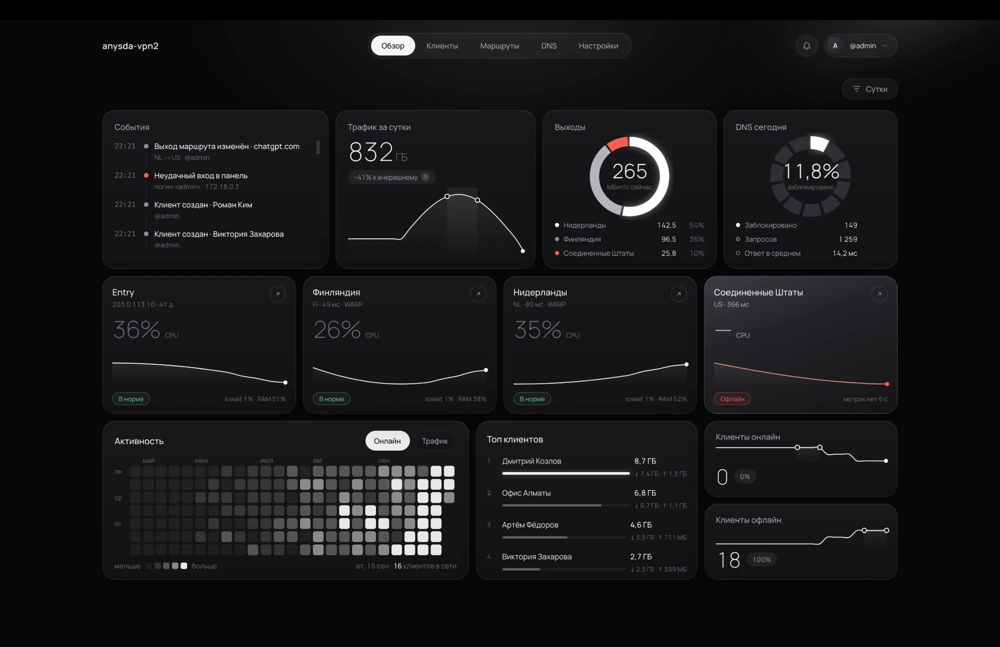
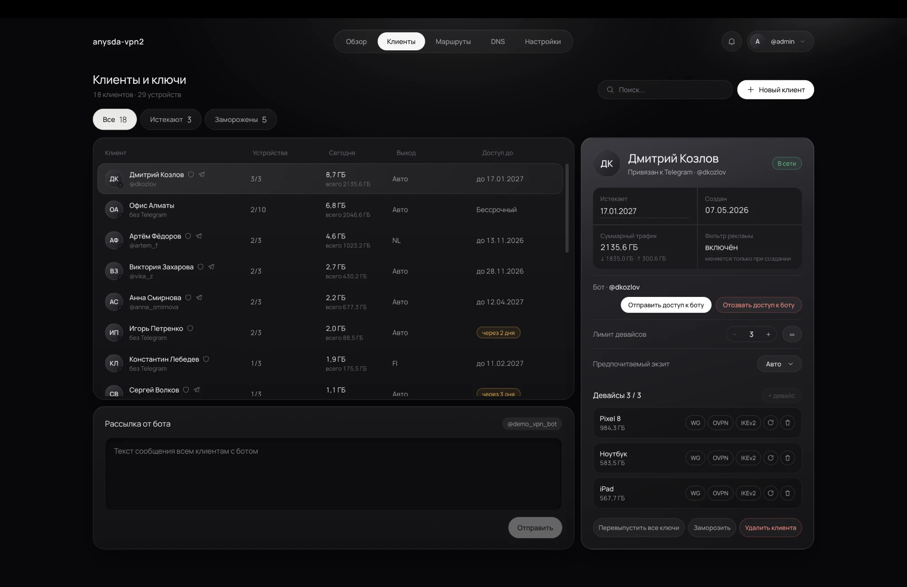

# anysda-vpn2

Самостоятельный VPN-сервис с веб-панелью: одна entry-нода в России, одна
или несколько exit-нод за рубежом, три протокола для клиентов (WireGuard,
OpenVPN, IKEv2), маршрутизация по географии, DNS с фильтрацией рекламы и
Telegram-бот. Ставится одной командой на чистые серверы.

> 🚀 **Сразу деплоить →** [Quickstart](#-quickstart--развернуть-с-нуля)



Обзор: события панели, трафик за сутки, нагрузка на экзиты, DNS с долей
блокировок. Ниже - карточки нод (CPU, iowait, RAM, статус), календарь
активности клиентов, топ клиентов по трафику и счётчики онлайн/офлайн.



Клиенты и ключи: список с трафиком за сегодня, экзитом и сроком доступа,
фильтры «истекают» и «заморожены», рассылка от бота. Справа - карточка
клиента: срок, суммарный трафик, привязка к Telegram-боту, лимит устройств,
предпочитаемый экзит. Снизу - устройства с трафиком и кнопками: WG
(`.conf`/QR), OVPN (`.ovpn`), IKEv2 (сервер, Remote ID, логин, пароль и CA
при работе без домена), перевыпуск ключей, удаление; заморозка и удаление
клиента.

## Возможности

- **Три протокола.** WireGuard, OpenVPN и IKEv2/IPsec на одной entry-ноде.
  IKEv2 работает штатными клиентами iOS, macOS, Windows и Android без
  сторонних приложений.
- **Клиенты и устройства.** Клиент - это человек, у него несколько
  устройств. У каждого устройства свои ключи WireGuard, сертификат OpenVPN
  и логин IKEv2. Лимит устройств, срок доступа, заморозка, перевыпуск
  ключей - из панели или из бота.
- **Маршрутизация по географии.** Российский трафик уходит напрямую с
  entry-ноды, зарубежный - через Hysteria2 на лучший экзит. Экзит падает -
  сторож переключает на другой за 10-14 секунд, живые соединения не
  рвутся. Подробности: [docs/routing.md](docs/routing.md),
  [docs/failover.md](docs/failover.md).
- **Ручные правила.** Домен, IP или подсеть на конкретный экзит,
  перетаскиванием в панели. Применяется на ходу, без перезапуска и без
  обрыва соединений.
- **Предпочитаемый экзит клиента.** Весь зарубежный трафик клиента через
  выбранную страну. Экзит пропал - трафик временно идёт через общий выбор,
  вернулся - возвращается сам.
- **YouTube без рекламы (опционально).** YouTube выводится с российского
  адреса entry-ноды, где реклама не показывается, а блокировка DPI
  обходится десинхронизацией TLS (zapret2). Видеопоток проверяется каждые
  пять минут; если обход сломался, YouTube уходит на экзиты. Подробности:
  [docs/youtube.md](docs/youtube.md).
- **Локальная сеть не ломается.** Домашние адреса (RFC1918, CGNAT,
  multicast) не уезжают в туннель: роутер, NAS, принтер и Chromecast
  остаются доступны при поднятом VPN.
- **DNS с фильтрацией.** AdGuard Home для клиентов с включённой
  фильтрацией, управление - во вкладке «DNS» панели. Подробности:
  [docs/adguard.md](docs/adguard.md).
- **Telegram-бот.** Администратор управляет клиентами и получает алерты.
  Конечный клиент по ссылке-приглашению сам скачивает конфиги, добавляет
  устройства и видит уведомления.
- **Мониторинг.** Нагрузка нод, трафик за сутки, задержка до экзитов,
  активность клиентов - в панели.
- **Резервные копии.** Один зашифрованный архив со всем нужным для
  восстановления entry-ноды, по расписанию, локально или в S3.
  Подробности: [docs/backup.md](docs/backup.md).
- **Вход в панель.** Один администратор, по желанию TOTP или SSO через
  OIDC-провайдера (проверено на Authentik): [docs/sso.md](docs/sso.md).

## Как это устроено

```
клиент WireGuard · OpenVPN · IKEv2
   │
   ▼
entry-нода (Россия)
 ├─ WireGuard / OpenVPN / strongSwan  →  sing-box (TPROXY)
 ├─ sing-box: ручные правила → YouTube → РФ напрямую → остальное на экзит
 ├─ сторож экзитов: пробы, переключение, балансировка
 ├─ zapret2: обход DPI для YouTube
 ├─ панель (Caddy, Let's Encrypt), AdGuard Home, VictoriaMetrics, бот
 │
 └─ Hysteria2 ──► exit-нода nl / fi / us / … ──► интернет
```

Exit-ноды связаны с entry-нодой туннелями Hysteria2 и служебной mgmt-сетью.
У каждого экзита два пути: прямой и через Cloudflare WARP. Полная схема
правил - [docs/routing.md](docs/routing.md).

**Стек.** Nuxt 4 (Vue 3, TypeScript) · Nuxt UI 4 · Drizzle ORM + SQLite ·
better-auth · sing-box · WireGuard · OpenVPN · strongSwan · AdGuard Home ·
VictoriaMetrics + node_exporter · Caddy · Python (`python-telegram-bot`).

**Структура репозитория.**

```
app/            панель (Nuxt 4)
infra/          деплой: стадии, шаблоны конфигов, сторож экзитов, тесты
telegram/       бот
deploy.sh       точка входа деплоя
setup.sh        интерактивный мастер config.yaml
config.example.yaml
docs/           инструкции и скриншоты
```

**Документация.**

| Файл | О чём |
|---|---|
| [docs/routing.md](docs/routing.md) | порядок правил sing-box, ручные маршруты, сплит-туннель, IPv6, почему не ходит ping, QUIC |
| [docs/failover.md](docs/failover.md) | сторож экзитов: пороги, дорожки и балансировка, выход бота, ручное выключение экзита |
| [docs/youtube.md](docs/youtube.md) | YouTube мимо экзитов: отбор трафика, стратегия десинка, A/B-проверка, видеопроба |
| [docs/backup.md](docs/backup.md) | состав архива, хранение, ротация, восстановление entry-ноды с нуля |
| [docs/creation.md](docs/creation.md) | подбор серверов до оплаты: SSH с entry, приёмка, разбор неудачи |
| [docs/recovery.md](docs/recovery.md) | замена умершего экзита, потеря entry, смена IP |
| [docs/adguard.md](docs/adguard.md) | AdGuard Home: прямой вход, учётка, лимиты |
| [docs/sso.md](docs/sso.md) | вход в панель через OIDC (Authentik) |
| [docs/speedtest.md](docs/speedtest.md) | BBR и Brutal на Hysteria2, замер скорости через туннель на стенде |

---

# 🚀 Quickstart — развернуть с нуля

Нужны: одна entry-нода в России и N exit-нод (минимум одна, лучше две-три
для отказоустойчивости). Чистая Ubuntu 24.04 или 26.04, root по
SSH-паролю. Деплой запускается с entry-ноды, она же оркестратор. Как
подобрать серверы до оплаты - [docs/creation.md](docs/creation.md).

| Нода  | Минимум                 | Рекомендуется           |
|-------|-------------------------|-------------------------|
| entry | 1 vCPU, 2 ГБ RAM, 10 ГБ | 2 vCPU, 2 ГБ RAM, 20 ГБ |
| exit  | 1 vCPU, 1 ГБ RAM, 5 ГБ  | 1 vCPU, 2 ГБ RAM, 10 ГБ |

Entry-нода упирается в процессор: один vCPU занят полностью уже на
~120 Мбит/с суммарно. Swap не нужен, лимиты служб подбираются по памяти.

**0. Домен (необязательно).** Направьте A-запись `vpn.example.com →
<entry-ip>` заранее: DNS расходится до четырёх часов, иначе Caddy не
получит сертификат при первом запуске. Только A-запись, без AAAA.

**1. Зайти на entry-ноду.**

```bash
ssh root@<entry-ip>
```

Если до этого сделать `ssh-copy-id root@<entry-ip>`, деплой подхватит ваш
ключ и разложит его на все exit-ноды. Без этого оркестратор сгенерирует
свой.

**2. Скачать исходники и манифест одной сборки.**

Для установки используется успешная сборка ветки `dev`. Манифест
`release-<полный commit>` находится в артефактах workflow
[images](https://github.com/anysda/vpn2/actions/workflows/images.yml).
GitHub требует вход для скачивания Actions-артефактов даже публичного
репозитория; публичного URL для анонимной загрузки сейчас нет.
Нужна учётная запись GitHub: команда `gh auth login` покажет код для
входа через браузер. Выпуски и теги для этого пути не нужны.

```bash
apt-get update
apt-get install -y git gh
gh auth login --hostname github.com --git-protocol https --web
git clone --branch dev https://github.com/anysda/vpn2 /opt/anysda-vpn2
cd /opt/anysda-vpn2

# Последняя успешная сборка images, а не обязательно текущая вершина dev.
run_id=$(gh run list --repo anysda/vpn2 --workflow images.yml --branch dev \
  --status success --limit 1 --json databaseId --jq '.[0].databaseId')
test -n "$run_id" && test "$run_id" != null || exit 1
commit=$(gh run view "$run_id" --repo anysda/vpn2 --json headSha --jq .headSha)
gh run download "$run_id" --repo anysda/vpn2 --name "release-$commit" \
  --dir "/opt/vpn2-release/$commit" || exit 1
git checkout --detach "$commit" || exit 1
cp "/opt/vpn2-release/$commit/release-manifest.json" ./release-manifest.json
python3 infra/lib/release.py --manifest release-manifest.json check . || exit 1
```

Ожидаемый вывод проверки: `release source: verified`. Скачивается
манифест именно выбранного commit; deploy сверяет хеши стадий и миграций,
образов и загружаемых компонентов. При ошибке скачивания остановитесь:
артефакты хранятся 90 дней; выберите более свежую успешную сборку на
странице `images`. Если успешной сборки с артефактом нет, установка с
проверкой требует исправленного CI. Не подставляйте манифест другой версии.

**3. Заполнить конфиг мастером.** Ответы попадут в `config.yaml`.

```bash
./setup.sh
```

**4. Запустить деплой.**

```bash
./deploy.sh --manifest release-manifest.json
```

Деплой ставит зависимости, проверяет SSH ко всем нодам, поднимает
mgmt-сеть и Hysteria2 на exit-нодах, а на entry-ноде - VPN-серверы, роутер,
сторож, AdGuard, мониторинг, панель и бота. Повторный запуск безопасен:
стадии идемпотентны.

`./deploy.sh --development` — отдельный режим разработки: разрешает
плавающие теги и установку без манифеста. Он не обеспечивает проверку
состава сборки и не нужен для установки по инструкции выше.

**5. Создать первого клиента.** В панели «Новый клиент» → имя → в карточке
клиента «+ девайс» → имя. Дальше кнопки WG (`.conf` или QR), OVPN, IKEv2.

Пароль администратора, если не задан в конфиге, генерируется при первом
деплое и лежит в `/etc/anysda/admin-password.txt` на entry-ноде.

---

## Настройка

Всё задаётся в `config.yaml`, образец с комментариями -
[config.example.yaml](config.example.yaml). После правки конфига
перезапустите `./deploy.sh --manifest release-manifest.json` целиком или
нужную стадию, например `./deploy.sh --manifest release-manifest.json 30-frontend ru`.

### Порты и параметры клиентских VPN

```yaml
ports:
  wireguard: 51820      # UDP
  openvpn: 1194         # UDP или TCP
openvpn:
  proto: udp            # udp | tcp, с суффиксами 4/6
wireguard:
  mtu: 1420             # 1280..9000, MTU клиента и MSS сервера
  split_local: true     # обход локальных сетей клиента (WG и OpenVPN)
```

Применить: `./deploy.sh 28-wireguard ru`, `./deploy.sh 29-openvpn ru`,
`./deploy.sh 30-frontend ru`. После смены порта, протокола, MTU или обхода
локальных сетей клиентам нужно скачать конфиги заново, ключи перевыпускать
не нужно. Порт должен быть открыт во внешнем firewall хостера.

### Домен и IKEv2

Без домена панель доступна по `https://<entry-ip>/`: Caddy выпускает
сертификат Let's Encrypt на публичный IP с профилем `shortlived` (около
6 дней). Окно продления настроено на возраст сертификата 5 суток; для
домена — на оставшиеся 7 дней. ACME Renewal Information может назначить
более раннее обновление. TCP 80 должен быть доступен извне для HTTP-01,
TCP 443 — для панели; HTTP/3 выключен, UDP 443 остаётся VPN.

Если первый выпуск не завершился за минуту, deploy выводит причину и
оставляет панель по HTTP. Caddy повторяет попытки с увеличивающейся паузой.
После выпуска таймер `vpn2-tls` включает HTTPS-редирект и Secure-cookie
(однократно перезапускает панель); CSRF использует тот же режим.
Сбой обновления не отключает действующий HTTPS. Через настроенного бота
администратор получает ошибку ACME и срок сертификата, не чаще одного
уведомления за 6 часов; после восстановления — «TLS: обновлено».
При недоступном боте сообщения сохраняются до доставки (до 32 последних).
Диагностика: `journalctl -u caddy -u vpn2-tls`, `systemctl list-timers vpn2-tls`.
Без настроенного Telegram-бота доступны журнал и локальная очередь.

Укажите `panel.domain`, направьте A-запись и запустите
`./deploy.sh --manifest release-manifest.json`.
Caddy получит сертификат Let's Encrypt на домен. IKEv2 до
этого работает по IP со своим CA, после - автоматически переключается на
домен и доверие к Let's Encrypt. **Профили IKEv2, выданные до подключения
домена, нужно скачать заново**: меняются сервер и Remote ID, логин и
пароль остаются. Диагностика: `journalctl -u anysda-ikev2-cert-sync -u caddy`.

### YouTube мимо экзитов

```yaml
youtube:
  route: zapret         # off | zapret | direct
  quic: block           # QUIC режется намеренно, десинк проверен на TCP
```

Проверка - только A/B, статус юнита ничего не доказывает:

```bash
ssh root@<entry> anysda-yt-check                    # 0 = обход живой
ssh root@<entry> 'journalctl -u anysda-yt-failover'  # журнал видеопробы
```

Если обход не проходит: `youtube.offload: off`, подобрать стратегию через
`/opt/zapret2/blockcheck2.sh` и записать в `youtube.strategy`, либо
`youtube.route: off`. Как это работает и что проверяет видеопроба -
[docs/youtube.md](docs/youtube.md).

### Сторож экзитов

Раз в две секунды сторож пробует каждый экзит. Три промаха подряд - экзит
считается мёртвым, новые соединения идут на другой, живые дорабатывают на
старом. Устройства разложены по 32 дорожкам, сторож держит каждую на
быстром экзите и выравнивает нагрузку. Экзит можно выключить вручную в
карточке экзита в панели. Пороги, балансировка и выход бота -
[docs/failover.md](docs/failover.md).

Стадии 20 (роутер) и 21 (сторож) обновляйте вместе:

```bash
./deploy.sh 20-ru-router ru && ./deploy.sh 21-failover-watchdog ru
```

### Отдельные стадии

```bash
./deploy.sh 30-frontend ru       # пересобрать панель
./deploy.sh 35-telegram ru       # перезапустить бота
./deploy.sh 10-foreign foreign   # все exit-ноды
./deploy.sh 19-yt-zapret ru      # обход DPI для YouTube
./deploy.sh 99-verify all        # проверка после деплоя
```

Полный список стадий - `infra/scripts/`.

## Резервные копии

`./deploy.sh backup` снимает один зашифрованный архив со всем, что нужно
для восстановления entry-ноды: база панели, секреты `/etc/anysda`,
серверный ключ WireGuard, CA и PKI OpenVPN, сертификаты IKEv2, хранилище
Caddy. Архив шифруется [`age`](https://github.com/FiloSottile/age) до
записи на диск.

```bash
./deploy.sh backup                    # снять архив сейчас
./deploy.sh backup-list               # список архивов
./deploy.sh restore                   # восстановить последний
./deploy.sh restore <archive> --force # перетереть непустую базу
```

По умолчанию архивы снимаются раз в сутки в 02:00 и хранятся в
`/var/backups/anysda-vpn2/` (последние 10). Для настоящего disaster
recovery архивы должны жить вне entry-ноды: S3 у другого провайдера или
синхронизация на удалённое хранилище.

**`config.yaml` - мастер-секрет.** В нём пароли всех нод, пароль панели,
токен бота, ключ оркестратора и passphrase архивов. Без passphrase архивы
нечитаемы. Храните копию вне entry-ноды, `chmod 600`, не коммитьте.

Состав архива, хранение в S3, ротация и пошаговое восстановление entry-ноды
с нуля - [docs/backup.md](docs/backup.md). Что делать, когда умер экзит
или entry, - [docs/recovery.md](docs/recovery.md).

## Telegram-бот

Опционален. Включается, если заданы `telegram.bot_token` и
`telegram.chat_id` (в `setup.sh` или в настройках панели). Админский чат -
личка с ботом или приватная группа с выключенным Group Privacy.

| Команда    | Что делает                                        |
|------------|---------------------------------------------------|
| `/clients` | список клиентов, создание, карточка с действиями  |
| `/status`  | состояние нод и задержка до экзитов               |
| `/nodes`   | список exit-нод с RTT                             |

В карточке клиента: заморозить, лимит устройств, срок, приглашение,
удалить. «Отправить приглашение» даёт ссылку `t.me/<bot>?start=…` для
пересылки клиенту: по ней бот привязывает его чат, и дальше клиент сам
скачивает конфиги, добавляет устройства и получает уведомления об
изменениях. «Отозвать доступ к боту» в панели отвязывает Telegram и
делает старую ссылку недействительной.

Бот не перевыпускает ключи, не трогает маршруты и не меняет свои
настройки - это только в панели.

## Лицензия

[MIT](LICENSE).
